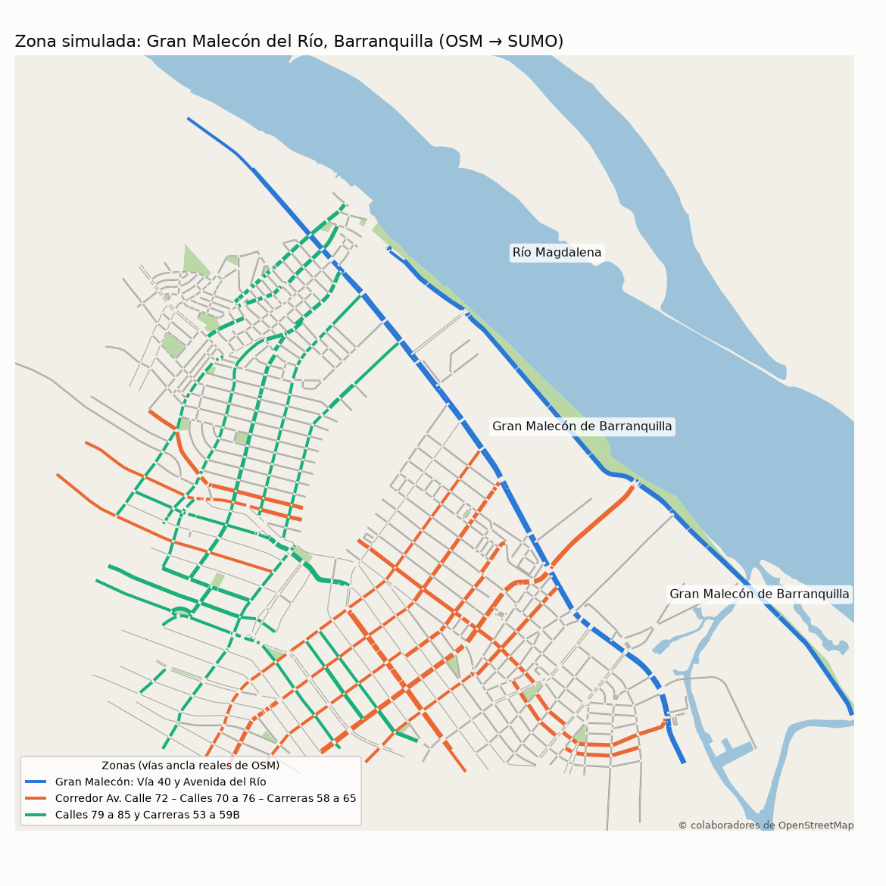

# Traffic on Barranquilla Simulation

**Simulación multiagente de conducción autónoma en la zona del Gran Malecón de
Barranquilla, con un vehículo instructor que enseña a conducir a los demás.**

Modelo de simulación hecho en Python sobre SUMO con la red vial real de
OpenStreetMap: Vía 40, Avenida del Río, Av. Calle 72, Calles 76–85 y Carreras 53–75,
con sus semáforos y señales de PARE. Cada vehículo autónomo lo conducen seis agentes
(Percepción, Señales, Obstáculos, Navegación, Velocidad y Seguridad) coordinados por
prioridades. El agente de Velocidad aprende con Double DQN; un vehículo ya entrenado
(el **instructor**) enseña a taxis, autos y buses aprendices, y la flota comparte lo
aprendido con aprendizaje federado (FedAvg / Flower). Incluye un **visor 3D del
Malecón** en el navegador.

| | |
|---|---|
| Escenario | Red real OSM → SUMO: 2 942 tramos, 50 semáforos, 11 PARE, aceras y cebras |
| Tráfico | autos, taxis, motos, buses y camiones + peatones (≈ 2 450 veh/h) |
| Imprevistos | peatones que cruzan a mitad de cuadra, perros, iguanas, carriles con conos, frenadas súbitas |
| Clima | despejado, lluvia (menos fricción y alcance) y noche (menos alcance, más ruido) |
| Agentes por vehículo | 6 + Coordinador (caso "Conducción urbana inteligente" de la tabla del profesor) |
| Aprendizaje | Double DQN en NumPy, interfaz Gymnasium, recompensas del Stack Tech |
| Enseñanza | instructor con *doble comando* + demostraciones + transferencia normalizada |
| Federado | FedAvg con validación, 3 zonas no-IID; versión distribuida con Flower + Docker Compose |



## Resultados principales

Detalle, figuras e intervalos de confianza en [docs/EXPERIMENTOS.md](docs/EXPERIMENTOS.md).

| Experimento | Resultado |
|---|---|
| E1 · El instructor aprende | De 7 km/h y 66 frenadas bruscas por episodio a ~30 km/h y 3–5; **0 choques en 40 evaluaciones** sin exploración; ningún rojo ni PARE cruzado |
| E2/E3 · El instructor enseña a un taxi | Con la copia normalizada + instructor, el taxi llega al nivel objetivo en **5 episodios** (18–34 aprendiendo solo); con solo doble comando termina más suave y rápido que solo |
| E4 · Automóvil → bus | Normalizado: el bus conduce igual que el automóvil. Copiado tal cual: **el bus no arranca** (1.8 km/h) |
| E5 · Flota federada en 3 zonas | El modelo FedAvg **no choca en ninguna zona** (0/18) y supera a los modelos locales, que fallan fuera de su zona; la nube rechazó un aporte dañino del bus |
| E6 · Reglas vs. DQN vs. híbrido | Seguridad estadísticamente equivalente: el aprendizaje alcanza a las reglas pero no las supera; su valor está en la transferencia |

La historia completa del entrenamiento (cuatro versiones fallidas, cómo se detectó cada
falla y cómo se corrigió) está en [docs/DECISIONES.md](docs/DECISIONES.md), D-11 a D-19.

## Documentación

| Documento | Contenido |
|---|---|
| [docs/PROPUESTA.md](docs/PROPUESTA.md) | Propuesta final (contrapropuesta sobre el Stack Tech), objetivos, alcance y cobertura de la tabla del profesor |
| [docs/ARQUITECTURA.md](docs/ARQUITECTURA.md) | PEAS, entorno, agentes, Coordinador, DQN, instructor, nube y contratos de cada agente |
| [docs/MODELO_SIMULACION.md](docs/MODELO_SIMULACION.md) | Entidades, reloj, distribuciones, supuestos, verificación y validación |
| [docs/DECISIONES.md](docs/DECISIONES.md) | Registro de decisiones del proyecto (qué, alternativas y por qué) |
| [docs/EXPERIMENTOS.md](docs/EXPERIMENTOS.md) | Diseño y resultados de los experimentos E1–E6 |
| [salidas/RESUMEN.md](salidas/RESUMEN.md) | Tablas numéricas con intervalos de confianza |

## Cómo ejecutarlo (Windows, PowerShell)

Requisitos: Python 3.11 o superior. SUMO se instala solo con `pip`.

```powershell
git clone https://github.com/vcalderonc/Traffic-on-Barranquilla-Simulation.git
cd Traffic-on-Barranquilla-Simulation
py -m venv .venv
.\.venv\Scripts\Activate.ps1
pip install -r requirements.txt
$env:PYTHONPATH = "src"
```

La red, la demanda y los modelos entrenados ya vienen en el repositorio, así que se
puede ir directo a ver resultados:

```powershell
# Visor 3D del Malecón (abrir http://localhost:8000 en el navegador)
python -m http.server 8000 -d visor

# El instructor conduciendo en la interfaz nativa de SUMO
python -m bq_sim gui --zona malecon_via40 --clima lluvia
```

Para regenerar todo desde cero (o `bash scripts/correr_experimentos.sh` para E2–E6 + visor + gráficas, ~1 h):

```powershell
python -m bq_sim red --descargar      # OSM -> red SUMO con PARE (necesita internet)
python -m bq_sim demanda              # tráfico de fondo y peatones
python -m bq_sim instructor           # E1: entrena el vehículo instructor (~25 min en un portátil de 2 núcleos)
python -m bq_sim aprendices           # E2/E3
python -m bq_sim bus                  # E4
python -m bq_sim federado --modo local
python -m bq_sim federado --modo fedavg
python -m bq_sim cruzada              # E5: evaluación cruzada
python -m bq_sim comparacion          # E6
python -m bq_sim graficas             # figuras y salidas/RESUMEN.md
python -m bq_sim visor                # ciudad + recorridos para el visor 3D
```

Aprendizaje federado distribuido con Flower (una terminal por proceso):

```powershell
python -m bq_sim.aprendizaje.flower_app servidor --rondas 3 --clientes 3 --inicial modelos/instructor_automovil.npz
python -m bq_sim.aprendizaje.flower_app vehiculo --perfil taxi --zona malecon_via40 --semilla 1
python -m bq_sim.aprendizaje.flower_app vehiculo --perfil automovil --zona corredor_calle72 --semilla 2
python -m bq_sim.aprendizaje.flower_app vehiculo --perfil bus --zona calles79_85 --semilla 3
```

O con Docker: `docker compose up --build` (los archivos están listos, pero Docker no se probó en el equipo de desarrollo; la versión con procesos sí se verificó).

## Estructura

```
src/bq_sim/
  config.py              parámetros del modelo (recompensas, climas, tasas de imprevistos)
  red.py                 OSM -> SUMO (netconvert) y PARE
  demanda.py             tráfico de fondo y peatones (randomTrips)
  entorno/
    mundo.py             conexión con SUMO, rutas por zona, geometría del camino
    eventos.py           imprevistos estocásticos (peatón, perro, iguana, conos, frenada)
    evaluador.py         recompensa y métricas (crítico)
    gym_env.py           entorno Gymnasium
  agentes/
    percepcion.py        sensores virtuales + rastreador
    especialistas.py     Señales, Obstáculos, Navegación, Seguridad
    velocidad.py         observación normalizada y agente de Velocidad
    vehiculo.py          Coordinador y vehículo autónomo
  aprendizaje/
    dqn.py               Double DQN en NumPy
    perfiles.py          perfiles físicos y normalización
    instructor.py        doble comando + demostraciones
    fedavg.py            FedAvg y base de conocimiento
    flower_app.py        versión distribuida con Flower (gRPC)
    entrenamiento.py     bucles de entrenamiento y evaluación
  experimentos.py        E1-E6
  graficas.py            figuras y tablas
  visor.py               exportación para el visor 3D y sumo-gui
data/osm/                extracto de OpenStreetMap (comprimido)
sumo/                    red, tipos de vehículo, demanda y configuración de SUMO
modelos/                 redes entrenadas (.npz)
salidas/                 CSV por episodio, figuras y RESUMEN.md
visor/                   visor 3D (index.html + app.js + datos/)
```

## Créditos y licencias de datos

Datos del mapa © colaboradores de OpenStreetMap, disponibles bajo la licencia
[ODbL](https://www.openstreetmap.org/copyright). Simulación con
[Eclipse SUMO](https://eclipse.dev/sumo/).
