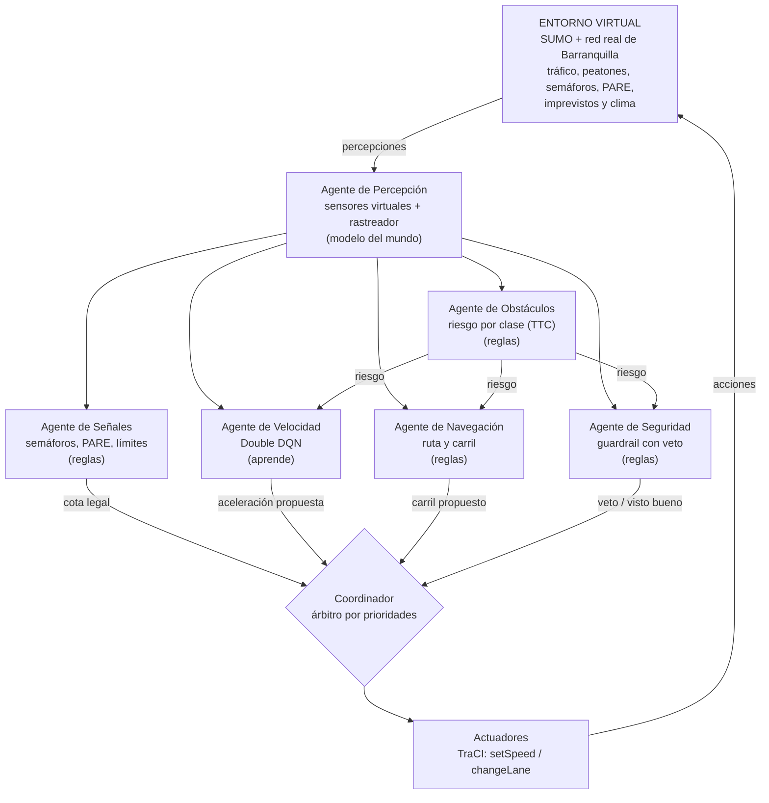
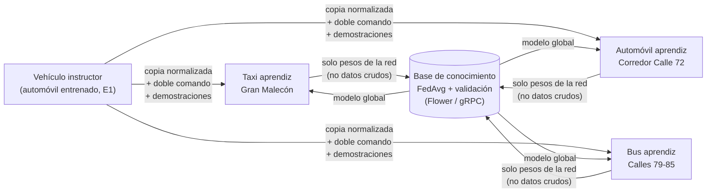

# Arquitectura del sistema multiagente

Este documento sigue la secuencia de diseño de la *Guía de Agentes Inteligentes*
(sección 13.1): problema → desempeño → entorno (PEAS) → observaciones y acciones →
autonomía → tipo de agente → mecanismo de decisión → restricciones → evaluación.

## 1. Problema y caso de uso

Corresponde al caso **1. Conducción urbana inteligente** de la tabla de casos de uso
que dio el profesor ("varios agentes conduciendo un mismo vehículo"):

| Caso | Agentes participantes | Problema de coordinación | Complejidad |
|---|---|---|---|
| Conducción urbana inteligente | Navegación, velocidad, obstáculos, señales, seguridad | Decidir cómo conducir respetando prioridades | Media-alta |

Además cubre total o parcialmente otros casos de la misma tabla (ver
[PROPUESTA.md](PROPUESTA.md#cobertura-de-la-tabla-del-profesor)).

Sobre ese vehículo multiagente se añade un **segundo nivel multiagente**: una flota
donde un **vehículo instructor** ya entrenado enseña a conducir a vehículos aprendices
(taxi, automóvil, bus) y todos comparten lo aprendido por una base de conocimiento
federada ("la nube").

## 2. PEAS del vehículo autónomo

| Elemento | Definición en este proyecto |
|---|---|
| **P** — desempeño | Cero choques; pocos casi-choques (TTC < 1 s); respetar semáforos, PARE y límites; pocas frenadas bruscas (confort); avanzar hacia el destino a buena velocidad. Se resume en la función de recompensa del Stack Tech (sección 6). |
| **E** — entorno | Red vial real de la zona del Gran Malecón de Barranquilla (OpenStreetMap → SUMO), con tráfico de fondo (autos, taxis, motos, buses, camiones), peatones en andenes y cebras, semáforos y PARE reales, e imprevistos estocásticos: peatones que cruzan a mitad de cuadra, perros, iguanas, carriles cerrados con conos y frenadas súbitas del vehículo de adelante. Tres climas: despejado, lluvia, noche. |
| **A** — actuadores | Aceleración longitudinal (7 niveles, como fracción de la capacidad del vehículo) y cambio de carril a la izquierda o derecha. Se aplican con TraCI (`setSpeed`, `changeLane`). |
| **S** — sensores | Cámara + LiDAR simulados: lista de objetos con clase, distancia, desplazamiento lateral y velocidad relativa, con alcance, ruido y omisiones que dependen del clima; estado del próximo semáforo; PARE próximo; límites de velocidad del camino. |

## 3. Características del entorno (guía, sección 3)

| Dimensión | Valor | Consecuencia de diseño |
|---|---|---|
| Observabilidad | **Parcial** (alcance limitado, ruido, omisiones, oclusión de noche y con lluvia) | El agente de Percepción mantiene **estado interno**: un rastreador que sostiene objetos 0.75 s aunque se dejen de ver. |
| Determinismo | **Estocástico** (tráfico, imprevistos, sensores) | Se decide con valores esperados (DQN) y se evalúa con varias semillas e intervalos de confianza. |
| Temporalidad | **Secuencial** | Frenar tarde hoy obliga a frenar en seco mañana: se necesita una política que mire hacia adelante (γ = 0.97 ≈ 8 s). |
| Dinamismo | **Dinámico** | Decisión cada 0.25 s; las reglas críticas (Seguridad) son reactivas y baratas. |
| Representación | **Continuo** (posiciones, velocidades) con acciones discretizadas | Observación continua normalizada; 7 acciones discretas. |
| Participantes | **Multiagente** (dentro del vehículo y en la flota) | Coordinador por prioridades y federación de conocimiento. |
| Conocimiento | Reglas de tránsito **conocidas**; dinámica de riesgo **desconocida** | Reglas donde bastan (Señales, Seguridad, Navegación) y aprendizaje donde no (Velocidad). |

## 4. Anatomía: los agentes que conducen un mismo vehículo

| Componente de la guía (sección 4) | Dónde está en el código |
|---|---|
| Percepción | `agentes/percepcion.py` — `AgentePercepcion` |
| Razonador / política | `agentes/velocidad.py` (DQN) + `agentes/especialistas.py` (reglas) + `agentes/vehiculo.py` (Coordinador) |
| Modelo del mundo | `ModeloMundo`: objetos rastreados, señal, límites del camino |
| Memoria | rastreador de Percepción; estado del PARE en Señales; memoria de repetición del DQN |
| Planificador | Navegación: ruta más corta sobre la red (`findRoute`) y carril que permite seguirla (`getBestLanes`) |
| Actuadores | `VehiculoAutonomo.actuar` |
| Función objetivo | `entorno/evaluador.py` (recompensa) |
| Guardrails | `AgenteSeguridad` + cotas de `AgenteSenales` |

### 4.1 Tipo de cada agente (guía, sección 5)

| Agente | Tipo clásico | Por qué |
|---|---|---|
| Percepción | Reactivo **basado en modelo** | Entorno parcialmente observable: necesita recordar lo que dejó de ver un instante. |
| Señales | Reactivo basado en modelo | Reglas de tránsito conocidas; guarda el estado de cada PARE (¿ya paró? ¿ya está libre?). |
| Obstáculos | Reactivo simple | Calcula TTC y brecha deseada (modelo tipo IDM) con lo percibido ahora. |
| Navegación | **Basado en metas** | Meta = destino; planifica ruta y carril. |
| Velocidad | **Agente que aprende** (sobre uno **basado en utilidad**) | El compromiso progreso / riesgo / confort no tiene una regla obvia; Q(s, a) es una utilidad esperada aprendida. |
| Seguridad | Reactivo simple con **veto** | Debe ser rápido, verificable y no depender del aprendizaje. |
| Coordinador | Software determinista | La guía (12.4) aclara que el orquestador no tiene que ser un agente. |

El conjunto es una **arquitectura híbrida por capas** (guía 6.1): una capa reactiva que
no se puede anular (Seguridad), una capa normativa (Señales), una capa que aprende
(Velocidad) y una capa deliberativa (Navegación).

## 5. Coordinación: decidir cómo conducir respetando prioridades

Cada agente devuelve una `Propuesta` (cota de aceleración, aceleración sugerida,
carril, veto y **motivo en texto**). El Coordinador aplica, en este orden:

1. **Seguridad** — si veta (TTC < 1.3 s con algo en la trayectoria o la distancia de
   frenado no alcanza con la fricción actual), se frena al máximo. Nadie la anula.
2. **Señales** — sus cotas son obligatorias: detenerse antes de la línea en rojo o en
   PARE, no exceder el límite actual ni el de la curva o calle siguiente. Con amarillo
   aplica la regla de la *zona de dilema*: si no alcanza a frenar con comodidad, sigue.
3. **Velocidad** — elige libremente dentro de lo permitido.
4. **Navegación** — pide el carril; Seguridad puede vetar el cambio si hay un vehículo
   en el carril destino.

Obstáculos no impone: informa el riesgo a Velocidad, a Seguridad y a Navegación.

Cada paso queda registrado con el **agente dominante** y el **motivo** (por ejemplo,
`senales: semáforo en rojo a 32 m` o `seguridad: frenado de emergencia: perro TTC 1.1 s`).
Esa traza es la que muestra el visor 3D y cumple el requisito de trazabilidad de la
guía (sección 15).

## 6. El agente que aprende (Velocidad)

**Algoritmo:** Double DQN (van Hasselt et al., 2016) con red objetivo suave (τ = 0.01),
pérdida de Huber, memoria de repetición de 60 000 transiciones y ε-greedy decreciente.
Red de 28 → 64 → 64 → 7, tasa de aprendizaje 3·10⁻⁴, implementada en NumPy (`aprendizaje/dqn.py`).

**Observación (28 valores, normalizados y sin unidades del vehículo):**

| Grupo | Valores |
|---|---|
| Estado propio | v/v_lím, v/20, aceleración previa / frenado máximo, v_lím/20 |
| Objeto más cercano en la trayectoria | riesgo por TTC, distancia/60, velocidad relativa/15, clase (vehículo, peatón, animal, obra), confianza del sensor, frenado requerido / frenado máximo |
| Segundo objeto en la trayectoria | riesgo por TTC, distancia/60 |
| Vulnerable junto a la vía | cercanía de un peatón o animal en el andén o carril vecino, distancia lateral |
| Señal próxima | distancia/120, estado (verde, amarillo, rojo, PARE), frenado requerido para detenerse |
| Límite próximo | frenado requerido para llegar al límite de la curva o calle siguiente |
| Contexto | fricción μ/0.8, alcance de sensores/90, carril bloqueado |
| Consejo de Obstáculos | aceleración que sugiere el agente de Obstáculos (modelo tipo IDM), normalizada |

**Acciones (7):** frenado de emergencia (−100 %), fuerte (−60 %), moderado (−30 %),
suave (−12 %), mantener, acelerar suave (+40 %), acelerar (+100 %), como fracción del
frenado o la aceleración máxima **del propio vehículo**.

**Recompensa** (Stack Tech, `config.Recompensas`):

| Evento | Valor |
|---|---|
| Choque | −100 (termina el episodio) |
| Casi-choque (TTC real < 1 s, una vez por objeto) | −10 |
| Cruzar un PARE sin detenerse | −20 |
| Cruzar un semáforo en rojo | −20 |
| Frenada brusca (desaceleración > 50 % de la máxima) | −0.1 por paso |
| Exceso de velocidad (> límite + 5 %) | −0.05 por paso |
| Intervención de Seguridad o del instructor | −1 |
| Ir lento sin motivo (< 40 % del límite sin obstáculo, señal ni curva) | −0.03 por paso |
| Progreso | +0.10 × min(v/v_lím, 1) por paso |
| Llegar al destino | +10 |

**Detalle importante:** en la memoria se guarda la acción **ejecutada** (después de las
cotas de Señales, del veto de Seguridad o de la corrección del instructor), no la que
propuso la política. Como DQN es *off-policy*, así aprende también de las correcciones.

**Interfaz Gymnasium:** `entorno/gym_env.py` (`reset`, `step`, `observation_space`,
`action_space`, `terminated`, `truncated`). Desde el punto de vista del agente de
Velocidad, los demás agentes del vehículo forman parte de su entorno, que es la
convención usual en aprendizaje por refuerzo multiagente.

## 7. Segundo nivel: la flota, el instructor y la nube

**Cómo enseña el instructor** (`aprendizaje/instructor.py`):

1. **Transferencia directa:** el aprendiz arranca con los pesos del instructor. Funciona
   entre tipos de vehículo porque la observación y las acciones están normalizadas.
2. **Doble comando:** el instructor ve lo mismo que el aprendiz; si el aprendiz elige una
   acción claramente menos prudente en una situación de riesgo, la reemplaza (como el
   pedal de freno del instructor de una escuela de conducción). El aprendiz recibe −1.
3. **Demostración:** en cada paso el instructor anota qué habría hecho; el aprendiz suma
   una pérdida de imitación con margen (DQfD, Hester et al., 2018) cuyo peso λ decae.

Con los episodios el instructor "suelta el volante": su tolerancia sube y λ baja hasta
cero. Las intervenciones por episodio miden cuánto aprendió el aprendiz.

**La nube** (`aprendizaje/fedavg.py`): FedAvg ponderado por pasos de simulación y una
validación que rechaza aportes cuya tasa de choques empeore la del modelo vigente. Las
tres zonas tienen tráfico e imprevistos distintos (datos *no-IID*). La misma lógica
corre distribuida con Flower sobre gRPC (`aprendizaje/flower_app.py`, `docker-compose.yml`).

**Topología** (guía 12.2): centralizada (servidor de conocimiento) para la flota y
jerárquica en conjunto (Coordinador dentro de cada vehículo, servidor por encima).

## 8. Contrato de cada agente (guía 13.2)

| Agente | Entradas | Acciones permitidas | Salidas | Restricciones | Escalamiento |
|---|---|---|---|---|---|
| Percepción | verdad del simulador (TraCI) | ninguna sobre el entorno | `ModeloMundo` | alcance y ruido según clima | — |
| Señales | `ModeloMundo` | ninguna directa | cota de aceleración + motivo | normas de tránsito colombianas | si no puede detenerse en amarillo, sigue (zona de dilema) |
| Obstáculos | `ModeloMundo` | ninguna directa | riesgo, amenazas ordenadas, aceleración sugerida | márgenes por clase (peatón 4 m, animal 3.5 m, obra 3 m, vehículo 2.5 m) | — |
| Navegación | `ModeloMundo`, ruta | pedir cambio de carril | carril objetivo + motivo | solo carriles que permiten seguir la ruta | si no hay carril alterno, se detiene tras el bloqueo |
| Velocidad | observación de 28 valores | 7 niveles de aceleración | aceleración propuesta | no puede saltarse cotas ni vetos | — |
| Seguridad | `ModeloMundo` | veto (frenado máximo), veto de carril | propuesta con veto | TTC crítico 1.3 s | toda intervención se registra y penaliza |
| Coordinador | 5 propuestas | aplicar aceleración y carril | `Decision` con agente dominante y motivo | orden fijo de prioridades | — |

## 9. Riesgos y mitigaciones (guía 15)

| Riesgo | Mitigación en el diseño |
|---|---|
| *Reward hacking* (p. ej. quedarse quieto para no chocar nunca; ocurrió en la versión 2, ver D-17) | penalización por ir lento sin motivo y premio por progreso; métricas separadas de la recompensa |
| Errores encadenados por percepción ruidosa | rastreador con memoria; Seguridad decide con la distancia de frenado física |
| Transferir conocimiento peligroso entre vehículos distintos | normalización por capacidad propia (experimento E4) |
| Un vehículo que aprendió mal contamina la flota | validación en la base de conocimiento (rechazo por tasa de choques) |
| Falta de trazabilidad | cada paso registra agente dominante y motivo; CSV por episodio |
