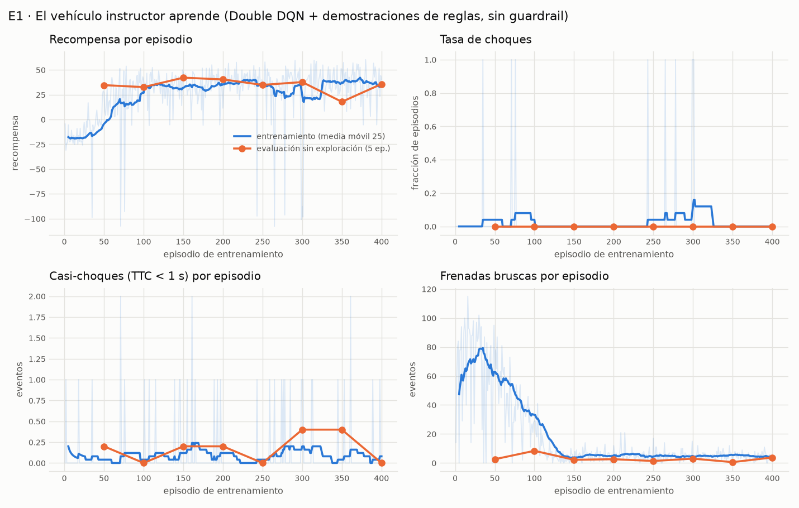
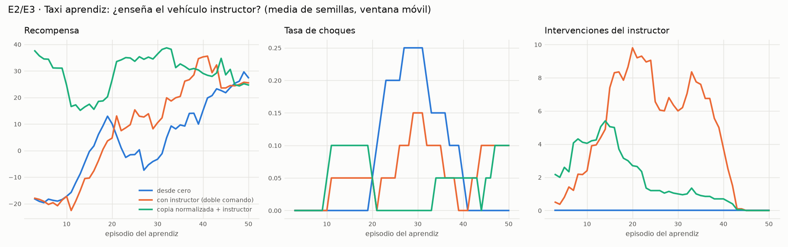
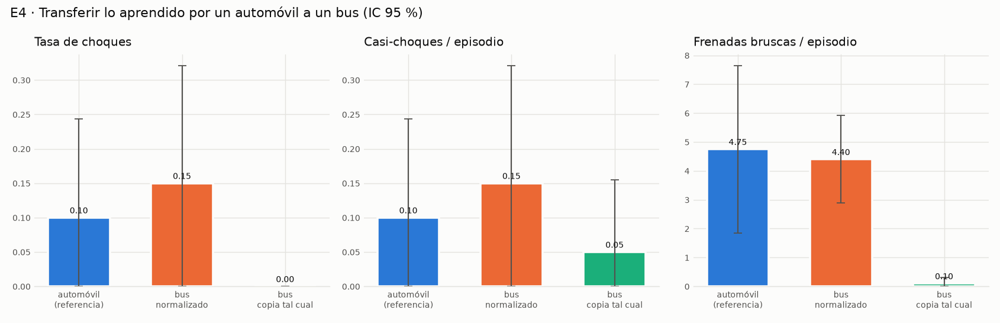
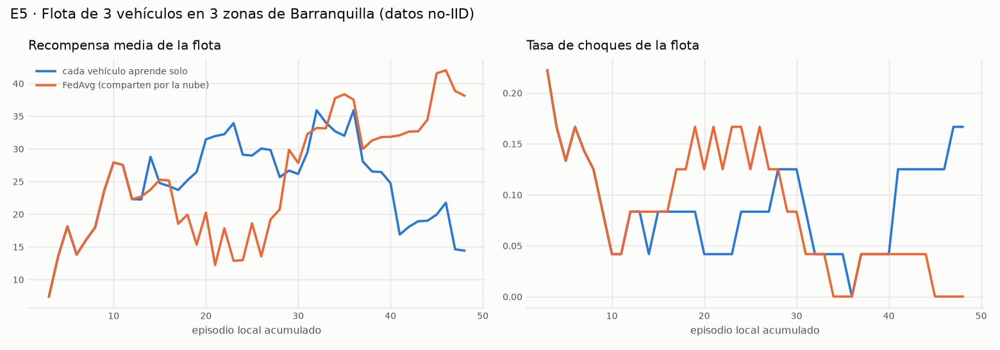
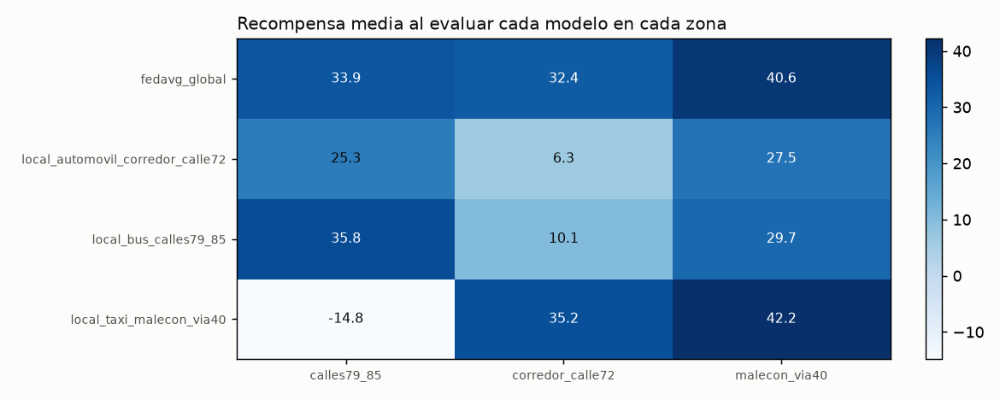
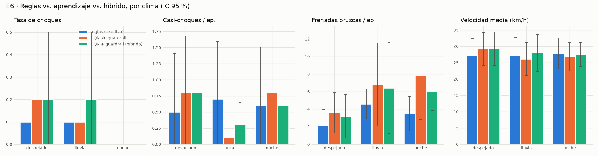

# Experimentos y resultados

Todos los experimentos se corren con `python -m bq_sim <comando>` (ver el README) y
dejan un CSV por episodio en `salidas/`. Las figuras están en `salidas/figuras/` y las
tablas con intervalos de confianza en [salidas/RESUMEN.md](../salidas/RESUMEN.md).

> **Limitación de E1–E7 (ver [D-26](DECISIONES.md)):** en estas corridas el tráfico de
> fondo y los peatones de SUMO solo se generaban hasta t = 4 000 s, y los episodios se
> encadenan sobre la misma simulación. Desde el episodio ~30 de cada experimento casi no
> entraba tráfico nuevo, así que los resultados describen sobre todo la conducción con
> semáforos, PARE, límites e imprevistos en vías poco congestionadas. La demanda ya está
> corregida (flujos sin horizonte y horas pico); para medir el desempeño en tráfico denso
> hay que continuar el entrenamiento y repetir los experimentos.

## Medidas de desempeño y dimensiones de evaluación de la guía (sección 15.1)

| Dimensión | Indicador en este proyecto |
|---|---|
| Eficacia | llegada al destino, distancia recorrida |
| Precisión / seguridad | tasa de choques, casi-choques (TTC < 1 s), TTC mínimo |
| Cumplimiento de normas | PARE violados / respetados, semáforos en rojo violados, pasos con exceso de velocidad |
| Eficiencia | velocidad media |
| Confort (trayectoria) | frenadas bruscas (desaceleración > 50 % de la máxima) |
| Robustez / adaptabilidad | desempeño con lluvia y de noche (E6), en otras zonas (E5) y en otro vehículo (E4) |
| Coordinación | intervenciones de Seguridad y del instructor; agente dominante por paso |
| Trazabilidad | motivo de cada decisión (visor 3D, `Decision.motivo`) |

## Diseño

| # | Pregunta | Variantes | Réplicas |
|---|---|---|---|
| E1 | ¿Aprende el vehículo instructor? | Double DQN + demostraciones de reglas, sin guardrail, 3 zonas y 3 climas | 400 episodios + 8 evaluaciones de 5 |
| E2/E3 | ¿Enseña el instructor? | Taxi aprendiz: desde cero · con instructor (doble comando + demostración) · copia normalizada + instructor | 50 episodios × 2 semillas por variante |
| E4 | ¿Se puede pasar lo aprendido a un bus? | Política del instructor en: automóvil (referencia) · bus normalizado · bus con la copia tal cual | 20 episodios por variante, mismos escenarios |
| E5 | ¿Sirve compartir por la nube? | Flota de 3 vehículos (taxi en el Malecón, automóvil en el corredor de la Calle 72, bus en las Calles 79–85): solo local · FedAvg | 4 rondas × 12 episodios por vehículo, partiendo del instructor; evaluación cruzada 6 episodios por modelo y zona |
| E6 | ¿Reglas, aprendizaje o híbrido? | Agente de reglas (IDM) · DQN sin guardrail · DQN + guardrail, por clima | 10 episodios por variante y clima |
| E7 | ¿Funciona el instructor en la red ampliada y con más tráfico? | Las mismas 3 variantes de E6 sobre las 10 vías seleccionables, a las 10:00, 17:48 o 21:00, con lluvia en ~1 de cada 4 | 12 episodios por variante, mismos escenarios |

En E2–E6 todas las variantes de una comparación ven **la misma secuencia de
escenarios** (zona y clima por episodio, misma semilla): números aleatorios comunes.

## Resultados

### E1 · El vehículo instructor aprende

Azul: episodios de entrenamiento (con exploración ε, sin guardrail). Naranja: cada 50
episodios, 5 episodios **sin exploración** en escenarios fijos (la política real).

| Bloque | Choques | Casi-choques / ep. | Frenadas bruscas / ep. | Vel. media | Llega al destino | Recompensa |
|---|---|---|---|---|---|---|
| Entrenamiento 1–50 (casi aleatorio) | 2 % | 0.06 | 66.2 | 6.8 km/h | 4 % | −11.3 |
| Entrenamiento 51–100 | 4 % | 0.06 | 41.0 | 24.5 km/h | 36 % | +22.1 |
| Entrenamiento 101–150 | 0 % | 0.12 | 7.9 | 28.7 km/h | 66 % | +33.1 |
| Entrenamiento 301–400 | 1 % | 0.09 | 4.8 | 29.5 km/h | 64 % | +36.0 |
| **Evaluación sin exploración (40 episodios)** | **0 %** | 0.18 | 3.1 | 33.3 km/h | 75 % | +34.5 |

**Lectura.** El instructor pasa de moverse a 7 km/h a pedazos (66 frenadas bruscas por
episodio) a conducir a ~30–33 km/h con 3–5 frenadas bruscas, llegando a destino en
tres de cada cuatro recorridos de 150 s. En las 40 evaluaciones sin exploración no
choca ni una vez, no cruza ningún rojo ni PARE y su TTC mínimo típico está lejos de la
zona crítica. Los pocos choques del entrenamiento (9 en 400 episodios) ocurren con
exploración aleatoria y son con iguanas (5, pequeñas y difíciles de detectar), peatones
(3) y conos (1), más frecuentes con lluvia (5.6 %) y de noche (3 %) que con cielo
despejado (0.7 %).

**Historia de la corrida** (ver [DECISIONES.md](DECISIONES.md)): esta es la versión 5.
Las anteriores fallaron de formas distintas y quedan guardadas en `salidas/` como
evidencia: v1 choques inevitables con peatones (D-11), v2 colapso a ir lento por
*reward hacking* (D-17), v3 seguro solo gracias a la exploración — 42 % de choques sin
ella (D-18) — y v4 colapso a quedarse quieto por el sesgo de la memoria de incidentes
(D-19).

### E2/E3 · ¿Enseña el instructor? (taxi aprendiz)

| Variante (2 semillas × 50 episodios) | Recompensa, primeros 10 ep. | Ep. hasta media móvil ≥ 25 | Últimos 20 ep.: vel. media | Últimos 20 ep.: frenadas bruscas | Últimos 20 ep.: recompensa | Recompensa media total |
|---|---|---|---|---|---|---|
| Desde cero | −17.2 | 18 y 32 | 20.8 km/h | 18.4 ± 4.6 | 21.2 ± 8.0 | 6.4 |
| Con instructor (doble comando + demostración) | −17.3 | 34 y 26 | 32.7 km/h | 8.0 ± 1.2 | 30.4 ± 10.2 | 11.7 |
| Copia normalizada + instructor | **+24.6** | **5 y 5** | 32.0 km/h | 8.2 ± 1.3 | 26.9 ± 11.1 | **28.3** |

**Lectura.**
* **Copiar el conocimiento normalizado** del instructor es lo que más ahorra: el taxi
  conduce bien desde el primer episodio y alcanza el nivel objetivo en 5 episodios en
  vez de 18–34. El instructor solo interviene ~1.7 veces por episodio y deja de hacerlo
  al final de la tutela.
* **El doble comando sin copiar pesos** no acelera el comienzo (el aprendiz arranca
  igual de torpe y el instructor tiene que intervenir hasta ~10 veces por episodio),
  pero el aprendiz **termina mejor** que el que aprendió solo: 33 km/h frente a 21 km/h
  y la mitad de frenadas bruscas en los últimos 20 episodios.
* Los choques son pocos en las tres variantes (3–7 %) y sus intervalos se solapan: con
  50 episodios no hay evidencia de diferencias en seguridad.

### E4 · ¿Se puede pasar lo aprendido a un bus?

| Variante (20 episodios, mismos escenarios) | Choques | Frenadas bruscas | Vel. media | Recompensa |
|---|---|---|---|---|
| Automóvil (referencia) | 10 % | 4.8 | 22.6 km/h | 19.8 ± 18.4 |
| Bus con conocimiento **normalizado** | 15 % | 4.4 | 26.9 km/h | 18.5 ± 23.6 |
| Bus con la copia **tal cual** | 0 % | 0.1 | **1.8 km/h** | −3.7 ± 2.5 |

**Lectura.** Con la normalización, el bus usa lo que aprendió el automóvil y conduce
de forma equivalente (las diferencias están dentro del intervalo de confianza). Sin
normalizar, el resultado no fue el esperado (frenar tarde y chocar) sino otro tipo de
falla: **el bus prácticamente no arranca**. Sus entradas (frenado requerido y consejo
de Obstáculos expresados con la capacidad de un automóvil) quedan fuera de lo que la
red vio al entrenar y la política se congela. No choca, pero no sirve: copiar el
conocimiento entre vehículos distintos sin normalizarlo lo vuelve inservible.

### E5 · ¿Sirve compartir por la nube? (aprendizaje federado no-IID)

Flota: taxi en el Gran Malecón, automóvil en el corredor de la Calle 72 y bus en las
Calles 79–85. Todos arrancan con el conocimiento del instructor y lo afinan 4 rondas ×
12 episodios en su zona. Con FedAvg, la nube combina los tres modelos al final de cada
ronda; en la ronda 2 **rechazó el aporte del bus** porque su tasa de choques empeoraba
la del modelo vigente (validación de la base de conocimiento).

| Modelo evaluado en las 3 zonas (6 episodios por zona) | Choques | Frenadas bruscas | Recompensa media |
|---|---|---|---|
| **FedAvg global** | **0 %** (0 de 18) | 3.3 | **35.6** |
| Solo local: taxi del Malecón | 11 % | 3.4 | 20.9 |
| Solo local: automóvil del corredor Calle 72 | 17 % | 5.3 | 19.7 |
| Solo local: bus de las Calles 79–85 | 6 % | 4.9 | 25.2 |

**Lectura.** Cada modelo local se especializa en su zona y generaliza peor fuera de
ella: el taxi entrenado en el Malecón obtiene 42.2 allí pero −14.8 en las Calles 79–85
(chocó en 2 de 6 episodios). El modelo federado es el único que no choca en ninguna
zona y tiene la mejor recompensa media. En el entrenamiento, la flota local se
desestabilizó en la ronda 4 (recompensa 33.8 → 16.2) mientras que la federada siguió
mejorando (34.3 → 34.5). Es el efecto que se buscaba con datos no-IID: compartir
experiencia de zonas distintas da una política más robusta. La muestra es pequeña
(6 episodios por celda), así que la conclusión es tentativa.

### E6 · ¿Reglas, aprendizaje o híbrido?

| Variante (30 episodios: 10 por clima) | Choques | Casi-choques | Frenadas bruscas | Vel. media | Recompensa |
|---|---|---|---|---|---|
| Conductor de reglas (reactivo) | 6.7 % | 0.60 | 3.4 | 27.4 km/h | 29.5 |
| DQN sin guardrail | 10.0 % | 0.57 | 6.1 | 27.4 km/h | 22.8 |
| DQN + guardrail (híbrido) | 13.3 % | 0.57 | 5.2 | 28.3 km/h | 18.2 |

**Lectura.** En seguridad las tres variantes son **estadísticamente equivalentes**
(intervalos que se solapan ampliamente con 10 episodios por celda). El instructor
alcanzó al conductor de reglas del que aprendió al comienzo, pero en 400 episodios no
lo superó: conduce algo más rápido y frena más brusco. De los 9 choques: 4 fueron con
**tráfico de fondo** (alcances o cruces que el ego no necesariamente provocó), 2 con un
mismo peatón que aparece a distancia casi nula (en las dos variantes DQN), 1 con una
iguana y 2 con los mismos **conos con TTC mínimo de 4.9 s**, es decir, un choque
**lateral durante un cambio de carril**, que el guardrail no cubre porque solo vigila
lo que está adelante en la trayectoria. Ningún
agente cruzó un semáforo en rojo ni un PARE.

Esto respalda el principio de parsimonia de la guía: donde las reglas ya resuelven el
problema, el aprendizaje no aporta mucho por sí solo. Su valor en este proyecto está en
lo que las reglas no hacen: **transferir y compartir conocimiento** entre vehículos y
zonas (E2–E5).

### E7 · Validación en la red ampliada (Buenavista, Calle 98, flujos de corredor)

La red se amplió (6 754 tramos, 146 semáforos, flujos en los grandes corredores; ver
DECISIONES D-20 y D-21) **después** de entrenar al instructor. E7 comprueba que su
conocimiento sirve en vías y condiciones que no vio: hora del día variable con el clima
dinámico (D-22) y lluvia.

| Variante (12 episodios) | Choques | Casi-choques | Frenadas bruscas | Vel. media | Rojos / PARE violados | Recompensa |
|---|---|---|---|---|---|---|
| Conductor de reglas | 8 % (1) | 0.00 | 4.1 | 28.5 km/h | 0 / 0 | 26.2 |
| DQN sin guardrail | 8 % (1) | 0.33 | 11.7 | 33.7 km/h | 0 / 0 | 29.4 |
| DQN + guardrail | 8 % (1) | 0.25 | 11.3 | 32.1 km/h | 0 / 0 | 23.0 |

**Lectura.** El instructor se transfiere a la red ampliada sin perder seguridad frente a
las reglas (un choque en 12 episodios en cada variante), va más rápido y frena más
brusco que el conductor de reglas, igual que en E6. Dos de los tres choques fueron con
vehículos de los flujos de corredor (con TTC no crítico para el ego: alcances o cruces)
y el tercero con un peatón bajo **lluvia de noche**, el escenario más difícil (alcance
de sensores ≈ 27 m). Ningún agente cruzó semáforos en rojo ni PARE.

**Recorridos grabados para el visor** (instructor con guardrail, 4 minutos): Malecón al
atardecer con ciclo día-noche, de día y de noche, y Calle 98 de noche frente a
Buenavista sin choques; Calle 84 con lluvia sin choques pero con mucho frenado (pare y
siga con pavimento mojado). Dos intentos en la **Vía 40 con lluvia terminaron chocando
con una iguana** (los animales pequeños se detectan tarde con lluvia y en esa zona hay
más); uno se conserva como `recorrido_6_via40_lluvia_choque_iguana.json`, ejemplo
documentado de una falla.

## Conclusiones

1. **La arquitectura multiagente funciona y es explicable.** Seis agentes y un
   Coordinador por prioridades conducen en la red real de Barranquilla sin cruzar
   rojos ni PARE en ningún experimento, y cada decisión queda trazada (agente
   dominante + motivo).
2. **El instructor aprende** a conducir a ~30 km/h con pocas frenadas bruscas y sin
   choques en las evaluaciones de E1, pero requirió anclarlo a las reglas: el
   aprendizaje por refuerzo puro fue frágil (4 versiones fallidas documentadas).
3. **El instructor sí enseña**: la copia normalizada de su conocimiento ahorra la mayor
   parte del aprendizaje del taxi (5 episodios frente a 18–34), y el doble comando deja
   un aprendiz más suave y rápido que uno que aprende solo.
4. **Normalizar es indispensable** para transferir entre vehículos distintos: sin
   normalización el bus no arranca.
5. **Compartir por la nube (FedAvg) generaliza mejor** que aprender solo en una zona,
   y la validación de aportes rechazó una actualización dañina.
6. **Frente al conductor de reglas**, el aprendizaje no mejora la seguridad: el valor
   del aprendizaje está en la transferencia, no en reemplazar las reglas.

## Limitaciones y trabajo futuro

* Muestras pequeñas por limitaciones de cómputo (portátil de 2 núcleos): las
  diferencias de choques entre variantes no son estadísticamente significativas.
* El guardrail solo vigila la trayectoria al frente; falta un chequeo **lateral** para
  los cambios de carril (choque con conos en E6).
* Los choques con tráfico de fondo se cuentan igual que los demás; convendría separar
  los que el ego provoca de los que recibe.
* Sin calibración con aforos reales ni tiempos reales de semáforos de Barranquilla.
* Animales pequeños con lluvia: la percepción los detecta tarde (choques con iguanas en
  la Vía 40 con lluvia); un sensor adicional o reducir la velocidad con lluvia en zonas
  de fauna serían mejoras naturales.
* Repetir E1–E6 sobre la red ampliada (los comandos son los mismos; ~2–3 h de cómputo).
* Despliegue en AWS EKS con nodos Spot (Stack Tech) y escenarios como el cierre de vías
  por arroyos en temporada de lluvias.
